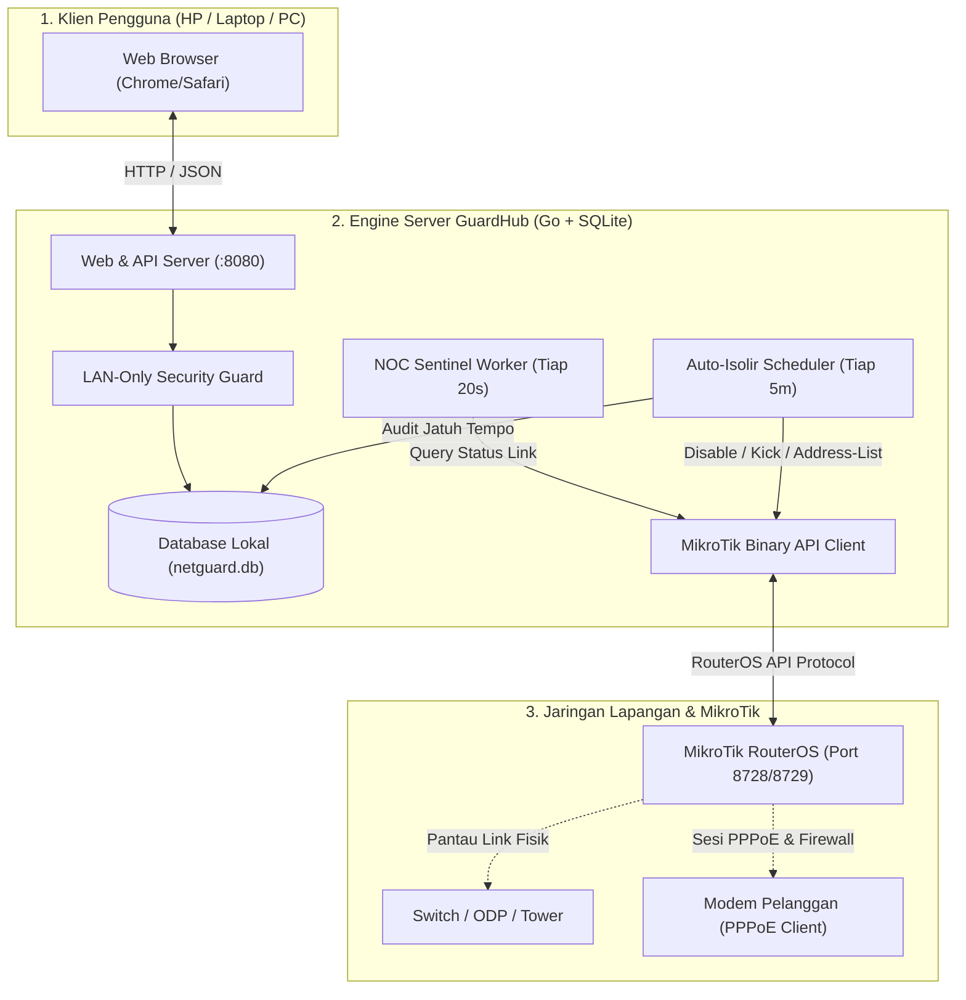
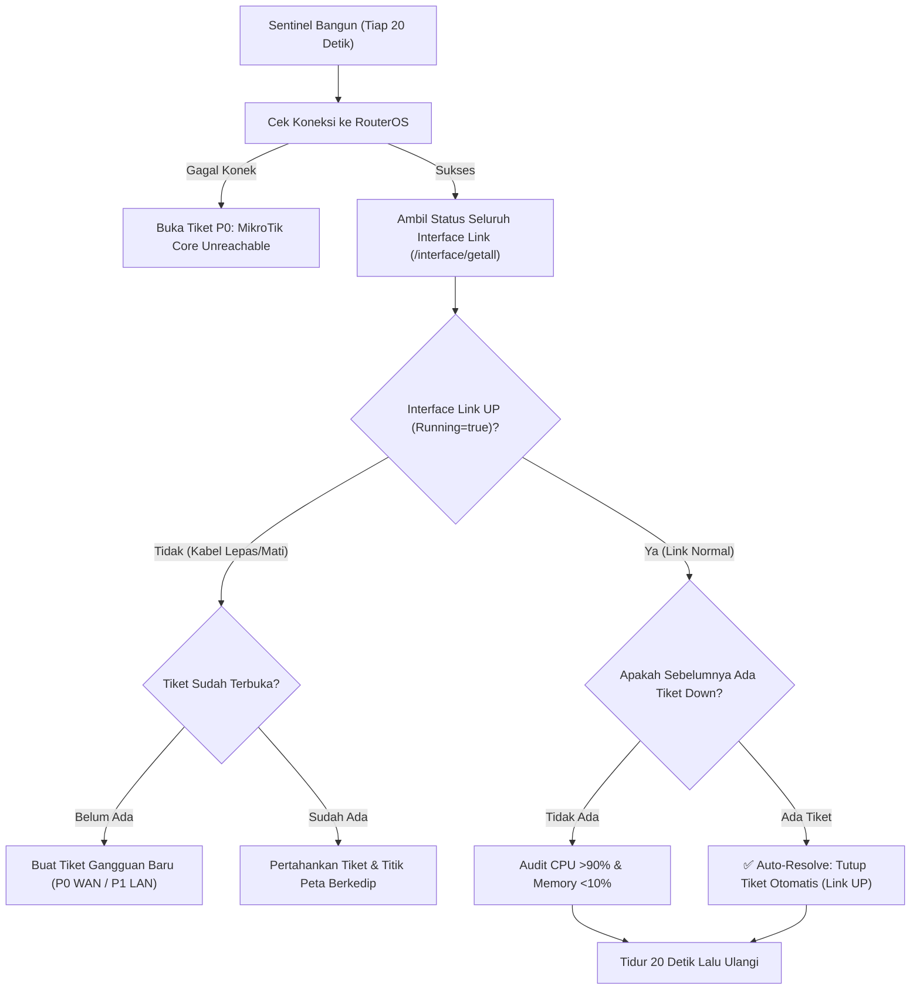
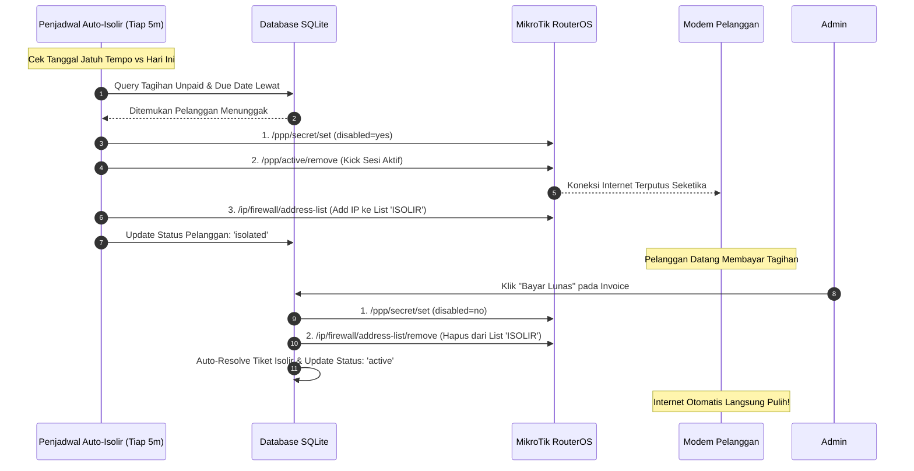

# 📖 Buku Panduan Lengkap Fitur GuardHub (NetGuard Hub)

Dokumen ini berisi penjelasan detail dan panduan operasional untuk setiap fitur yang tersedia di **GuardHub (NetGuard Hub)** — platform Web Server NOC Automation, ISP Billing, dan MikroTik RouterOS Manager.

---

## 📑 Daftar Isi
1. [Arsitektur & Konsep Dasar Web Server Multi-Device](#1-arsitektur--konsep-dasar-web-server-multi-device)
2. [Cara Kerja Sistem GuardHub (Arsitektur & Alur Kerja Lengkap)](#2-cara-kerja-sistem-guardhub-arsitektur--alur-kerja-lengkap)
   - [Alur 1: Cara Kerja Konektor & Kendali MikroTik RouterOS](#alur-1-cara-kerja-konektor--kendali-mikrotik-routeros)
   - [Alur 2: Cara Kerja Sentinel Auto-Detector & Tiket Insiden Otomatis](#alur-2-cara-kerja-sentinel-auto-detector--tiket-insiden-otomatis)
   - [Alur 3: Cara Kerja Sistem Billing, Auto-Isolir Tunggakan & Pemulihan Instan](#alur-3-cara-kerja-sistem-billing-auto-isolir-tunggakan--pemulihan-instan)
   - [Alur 4: Cara Kerja Peta Geografis, Titik Device & Anti-Titik Tumpuk](#alur-4-cara-kerja-peta-geografis-titik-device--anti-titik-tumpuk)
   - [Alur 5: Cara Kerja Akses Jaringan Multi-Device Tanpa APK & Keamanan LAN](#alur-5-cara-kerja-akses-jaringan-multi-device-tanpa-apk--keamanan-lan)
3. [Fitur 1: Wadah Koneksi & MikroTik Hub (RouterOS Full Access)](#3-fitur-1-wadah-koneksi--mikrotik-hub-routeros-full-access)
4. [Fitur 2: NOC Sentinel Auto-Detector & Tiket Gangguan](#4-fitur-2-noc-sentinel-auto-detector--tiket-gangguan)
5. [Fitur 3: Peta Gangguan GIS & Pemetaan Titik Device Masing-Masing](#5-fitur-3-peta-gangguan-gis--pemetaan-titik-device-masing-masing)
6. [Fitur 4: Manajemen Pelanggan PPPoE & Perekaman GPS Rumah](#6-fitur-4-manajemen-pelanggan-pppoe--perekaman-gps-rumah)
7. [Fitur 5: Billing, Tagihan & Penjadwal Auto-Isolir MikroTik](#7-fitur-5-billing-tagihan--penjadwal-auto-isolir-mikrotik)
8. [Fitur 6: Live Firewall Address-List & Riwayat Log](#8-fitur-6-live-firewall-address-list--riwayat-log)
9. [Fitur 7: Panduan Akses LAN & Setup Domain guardhub.com](#9-fitur-7-panduan-akses-lan--setup-domain-guardhubcom)

---

## 1. Arsitektur & Konsep Dasar Web Server Multi-Device

GuardHub dirancang sebagai **Web Server mandiri (standalone)** yang menggabungkan backend performa tinggi (Go Gin + SQLite WAL Mode) dengan antarmuka modern (React + Leaflet + Tailwind CSS).

- **Tanpa Perlu Instal APK:** Seluruh staf, teknisi lapangan, maupun pemilik usaha dapat membuka sistem langsung melalui browser (Chrome, Safari, Firefox, Edge) dari Laptop, Komputer NOC, Tablet, hingga HP Android/iPhone.
- **Proteksi Keamanan LAN-Only:** Middleware GuardHub secara otomatis memeriksa IP pengunjung. Jika ada akses mencurigakan dari internet publik luar, sistem otomatis memblokirnya (`403 Forbidden`). Hanya IP privat lokal Wi-Fi/LAN yang diizinkan masuk.
- **Database Terintegrasi:** Seluruh data pelanggan, tiket, koordinat peta, perangkat, dan tagihan tersimpan di database lokal `./netguard.db` yang aman dan tidak memerlukan instalasi database server eksternal seperti MySQL atau PostgreSQL.

---

## 2. Cara Kerja Sistem GuardHub (Arsitektur & Alur Kerja Lengkap)

Bagian ini menjelaskan bagaimana GuardHub bekerja di balik layar, mulai dari saat server pertama kali dinyalakan hingga bagaimana automasi jaringan dieksekusi secara otomatis.



---

### Alur 1: Cara Kerja Konektor & Kendali MikroTik RouterOS
1. **Penyimpanan Kredensial Dinamis:**
   - Ketika Anda memasukkan IP (contoh: `192.168.88.1`), Port (`8728`), Username, dan Password di menu **MikroTik Hub**, GuardHub menyimpannya ke tabel `settings` di database SQLite lokal.
2. **Komunikasi Biner Native (Bukan SSH Lambat):**
   - Backend Go menggunakan socket TCP langsung ke port API MikroTik (`8728` standar atau `8729` dengan enkripsi TLS).
   - Setiap perintah dikemas dalam format *word-length binary encoding* RouterOS, sehingga respons balik diterima dalam hitungan **milidetik** (jauh lebih cepat dan hemat memori dibanding scraping webfig atau terminal SSH).
3. **Penerjemahan Perintah Otomatis:**
   - Ketika Anda menekan tombol di web (misal *Kick User*, *Tambah Secret*, atau *Disable User*), GuardHub langsung menerjemahkannya ke kalimat RouterOS:
     - Kick Sesi: `/ppp/active/remove =.id=*1`
     - Isolir Secret: `/ppp/secret/set =.id=*2 =disabled=yes`
     - Baca Resource: `/system/resource/print`
4. **Fallback & Auto-Reconnect:**
   - Jika router sempat mati lampu atau reboot, GuardHub tidak akan crash. Koneksi socket akan ditutup dengan rapi dan dibuka kembali secara otomatis saat router menyala kembali.

---

### Alur 2: Cara Kerja Sentinel Auto-Detector & Tiket Insiden Otomatis
Sentinel berfungsi sebagai robot NOC virtual yang memantau kondisi router dan interface jaringan tanpa henti.



1. **Siklus 20 Detik:**
   - Thread background `sentinelWorker` di backend Go aktif setiap 20 detik secara non-blocking (tidak membuat web menjadi lambat).
2. **Inspeksi Interface:**
   - Sentinel menanyakan status `/interface/print`. Bila ada port (misal `ether1-WAN` atau `ether3-Distribusi`) yang berstatus `running=false`, Sentinel mendeteksi terjadinya *cable unplugged* atau link putus.
3. **Pembuatan Tiket Otomatis:**
   - Jika interface tersebut adalah port WAN utama, Sentinel membuka tiket **P0 - Kritis**.
   - Jika port LAN/distribusi, dibuka tiket **P1 - Tinggi**.
   - Di tab **🗺️ Peta Gangguan**, marker perangkat tersebut langsung berkedip merah dan memicu status insiden.
4. **Pemulihan Otomatis (Self-Healing / Auto-Resolve):**
   - Saat kabel dicolokkan kembali oleh teknisi dan port kembali `running=true`, Sentinel seketika mendeteksi pemulihan dan **menutup tiket insiden secara otomatis** dengan catatan waktu pulih.

---

### Alur 3: Cara Kerja Sistem Billing, Auto-Isolir Tunggakan & Pemulihan Instan
GuardHub menerapkan perlindungan pendapatan ISP melalui mekanisme isolir berlapis (*Dual-Layer Blocking*).



1. **Audit Tiap 5 Menit:**
   - Thread background memeriksa seluruh invoice berstatus `unpaid`. Jika tanggal hari ini > tanggal jatuh tempo (`due_date`), proses isolir langsung dijalankan.
2. **Pemblokiran Lapis 1 (PPPoE Secret & Kick):**
   - GuardHub menonaktifkan akun PPPoE (`disabled=yes`) di MikroTik dan langsung menghapus sesi login aktifnya (`/ppp/active/remove`). Modem pelanggan seketika gagal dial-up.
3. **Pemblokiran Lapis 2 (Firewall Address-List):**
   - IP pelanggan dicatat ke dalam daftar `/ip/firewall/address-list` dengan nama **`ISOLIR`**. RouterOS dapat dipadukan dengan filter firewall NAT untuk mengarahkan browsing pelanggan ke halaman informasi pembayaran.
4. **Pemulihan Instan Saat Pembayaran Dilunasi:**
   - Begitu kasir atau admin menekan tombol **"Bayar Lunas"** di tab Tagihan:
     - Invoice ditandai lunas (`status=paid`, `paid_at=sekarang`).
     - Backend seketika mengirim perintah `/ppp/secret/set =disabled=no`.
     - IP pelanggan langsung dihapus dari daftar blokir firewall `ISOLIR`.
     - Tiket isolir otomatis ditutup. Pelanggan dapat langsung berinternet kembali tanpa perlu admin me-reboot router atau menghapus rule manual di Winbox.

---

### Alur 4: Cara Kerja Peta Geografis, Titik Device & Anti-Titik Tumpuk
1. **Penggabungan Titik Terpadu (`/api/v1/map/points`):**
   - Backend mengumpulkan 4 jenis entitas:
     - **📡 Router Pusat NOC** (dari pengaturan koordinat NOC).
     - **🖥️ Node Infrastruktur** (Switch, ODP, Tower, Server dari tabel `monitored_devices`).
     - **🏠 Pelanggan CPE** (Rumah pelanggan yang sudah memiliki titik GPS dari tabel `customers`).
     - **🚨 Tiket Gangguan Aktif** (Insiden dari tabel `tickets`).
2. **Algoritma Spiral Emas (Anti-Titik Tumpuk / Micro-Offset):**
   - Jika ada beberapa insiden atau node berada di titik yang sama persis (misal 5 tiket terbuka pada 1 Router NOC), marker tidak akan saling menumpuk menjadi 1 titik tak terlihat.
   - Algoritma *Golden Angle Spiral* memberi pergeseran mikro sekitar ~10-15 meter secara memutar, sehingga semua marker tetap terlihat dan dapat diklik secara terpisah.
3. **Navigasi Cepat 1-Klik (FlyTo Engine):**
   - Saat Anda mengklik chip device di atas peta atau tombol **`📍 Peta`** di tab tiket/pelanggan, sistem menjalankan fungsi `map.flyTo([lat, lng], 17)` dengan interpolasi animasi halus, lalu membuka jendela *popup* informasi perangkat secara otomatis.
4. **Tile Layer Anti-Gelap:**
   - Server tile CARTO dan OSM dibatasi pada `maxNativeZoom: 18-19`, namun Leaflet diizinkan melakukan *upscale* hingga level 21. Dengan cara ini, peta tidak akan pernah mengalami layar hitam (error 403) saat Anda memperbesar tampilan hingga ke gang rumah.

---

### Alur 5: Cara Kerja Akses Jaringan Multi-Device Tanpa APK & Keamanan LAN
1. **Listening pada Seluruh Interface (`0.0.0.0:8080`):**
   - Go Server berjalan dan mendengarkan koneksi dari semua kartu jaringan yang terpasang (Wi-Fi, Ethernet, LAN).
2. **Integrasi DNS Statis MikroTik:**
   - Tombol *"Pasang Domain guardhub.com"* menambahkan rule: `/ip/dns/static/add name=guardhub.com address=<IP-Server>`.
   - Ketika ada perangkat di jaringan Wi-Fi yang mengetik `http://guardhub.com:8080`, MikroTik langsung mengarahkan request tersebut ke komputer server GuardHub.
3. **Filter Keamanan LAN-Only (IP Firewall Middleware):**
   - Setiap koneksi masuk diperiksa IP asalnya.
   - **Diizinkan:** `127.0.0.1` (localhost), `10.0.0.0/8`, `172.16.0.0/12`, `192.168.0.0/16`, dan subnet CGNAT `100.64.0.0/10`.
   - **Ditolak:** Jika request berasal dari IP publik internet luar, server langsung mengembalikan respons `403 Forbidden` demi menjaga privasi dan keamanan server NOC Anda.

---

## 3. Fitur 1: Wadah Koneksi & MikroTik Hub (RouterOS Full Access)

Fitur ini berfungsi sebagai wadah perantara agar aplikasi web GuardHub dapat terhubung ke MikroTik RouterOS mana saja secara dinamis dan mendapatkan kendali penuh.

### Kemampuan & Fungsi:
1. **Konektor Multi-MikroTik Dinamis:**
   - Anda dapat menghubungkan GuardHub ke MikroTik kantor, MikroTik lab, maupun MikroTik server pusat milik bos Anda.
   - Pengaturan mencakup: **IP / Host Router** (misal `192.168.88.1`, `10.10.1.1`, atau domain DDNS), **Port API** (default: `8728` atau SSL `8729`), **Username** (misal: `admin`), dan **Password**.
   - Dilengkapi tombol **"🧪 Tes Koneksi"** untuk memvalidasi status koneksi sebelum disimpan.
2. **Pemantau Sumber Daya Live (Live Resource Monitor):**
   - Menampilkan persentase beban CPU (*CPU Load %*), kapasitas RAM tersisa (*Free Memory*), Total RAM, Uptime router, arsitektur CPU, dan versi RouterOS.
3. **Manajemen Secrets PPPoE:**
   - Menampilkan seluruh akun PPPoE yang ada di MikroTik.
   - Anda dapat menambah secret baru, mengubah password, mengganti profil paket kecepatan, serta mengaktifkan/menonaktifkan (*enable/disable*) user.
4. **Live Active Connections & Kick User:**
   - Menampilkan daftar pelanggan yang sedang tersambung online saat ini, lengkap dengan IP address dinamis yang didapatkan, waktu online (*uptime*), dan MAC Address (*Caller ID*).
   - Tombol **"Kick"** dapat memutuskan sesi koneksi secara instan (berguna jika router pelanggan mengalami *hang* atau perlu dial ulang).
5. **Sinkronisasi 1-Klik (Import / Export):**
   - **Impor dari MikroTik:** Mengambil seluruh akun PPPoE yang sudah ada di router dan otomatis memasukkannya ke database pelanggan GuardHub beserta paketnya.
   - **Ekspor ke MikroTik:** Mendaftarkan seluruh pelanggan di GuardHub ke RouterOS secara massal.
6. **Terminal Eksekusi Perintah RouterOS:**
   - Memungkinkan eksekusi perintah RouterOS langsung dari web dengan dukungan argumen berpetik atau berspasi (contoh: `/interface/print`, `/system/reboot`, `/log/print`).
7. **Pasang DNS guardhub.com ke MikroTik:**
   - Dengan 1 klik, sistem mendaftarkan entri DNS statis di MikroTik sehingga semua HP/laptop yang tersambung ke Wi-Fi dapat mengakses web ini cukup dengan mengetik `http://guardhub.com:8080`.

---

## 4. Fitur 2: NOC Sentinel Auto-Detector & Tiket Gangguan

Fitur ini berfungsi layaknya robot pengawas (NOC Engineer virtual) yang memantau kesehatan jaringan 24 jam nonstop tanpa perlu dilihat terus-menerus.

### Kemampuan & Fungsi:
1. **Pemeriksaan Otomatis Tiap 20 Detik:**
   - Sentinel memeriksa status fisik interface link (apakah kabel WAN/LAN terhubung atau lepas/down).
   - Memeriksa beban CPU jika melebihi 90% secara terus-menerus.
   - Memeriksa sisa memori jika menipis di bawah 10%.
2. **Pembagian Level Masalah (Priority):**
   - **P0 - Kritis (Merah Berkedip):** Jika interface WAN utama putus atau Router MikroTik pusat tidak dapat dihubungi.
   - **P1 - Tinggi (Oranye):** Jika salah satu interface link LAN/port distribusi pelanggan mati (*down*) atau CPU overload.
   - **P2 - Normal (Kuning):** Laporan tiket manual non-kritis.
3. **Penyelesaian Otomatis (Auto-Resolve):**
   - Jika teknisi memasang kembali kabel yang lepas dan link port kembali *UP*, Sentinel secara otomatis menandai tiket tersebut sebagai **Resolved / Pulih** tanpa perlu diklik manual oleh operator.
4. **Pindai Masalah MikroTik (Diagnosa On-Demand):**
   - Tombol audit seketika untuk melihat rangkuman port down, log error, dan pemakaian memori saat jaringan terasa lambat.
5. **Tombol "📍 Peta" Pada Tiket:**
   - Di setiap tiket yang tercatat nama devicenya (misal `SW-JKT-01` atau `mikrotik-if-ether1`), terdapat tombol **`📍 Peta`**. Ketika diklik, sistem langsung beralih ke tab peta dan memusatkan kamera ke lokasi fisik alat tersebut.

---

## 5. Fitur 3: Peta Gangguan GIS & Pemetaan Titik Device Masing-Masing

Fitur visualisasi geografis interaktif yang memetakan seluruh infrastruktur jaringan hingga ke rumah pelanggan di atas peta digital.

### Kemampuan & Fungsi:
1. **Multi-Pilihan Tile Peta (Anti-Gelap / Anti-403):**
   - **🗺️ Voyager (CARTO):** Peta terang yang sangat jelas menampilkan gang, nomor jalan, dan batas wilayah perumahan.
   - **🛣️ OSM Detail Jalan:** Peta OpenStreetMap dengan detail fasilitas umum hingga zoom 19.
   - **🛰️ Satelit Asli (Esri World Imagery):** Citra satelit asli untuk melihat atap rumah, tiang, pohon, dan jalur kabel di lapangan.
   - **☀️ Terang (Positron):** Tampilan minimalis bersih.
   - **🌙 Dark NOC:** Tampilan gelap bernuansa ruang monitor NOC modern.
   *(Semua peta dioptimalkan hingga zoom level 21 tanpa resiko layar hitam).*
2. **Titik Device Masing-Masing & Quick Device Chips:**
   - Di bagian atas peta terdapat baris cepat seluruh perangkat infrastruktur terdaftar (NOC Core Router, Switch Distribusi, Router Cabang, Server DC, ODP tiang).
   - Klik pada chip nama device untuk membuat peta **langsung terbang (*flyTo*)** dengan animasi halus ke titik GPS perangkat tersebut dan membuka jendela informasinya.
3. **Garis Topologi Jaringan:**
   - Menghubungkan Router Pusat NOC dengan seluruh switch, ODP, dan pelanggan.
   - Jika perangkat normal: garis berwarna biru / hijau.
   - Jika perangkat mengalami gangguan atau terisolir: garis berubah menjadi **merah putus-putus**.
4. **Modal Kelola Node Infrastruktur & Kalibrasi Titik:**
   - **🎯 Fokus di Peta:** Memusatkan dan memperbesar tampilan peta ke titik device.
   - **📌 Pin Peta (Mode Kalibrasi):** Mengaktifkan mode klik peta. Anda cukup mengklik titik tiang/lokasi baru di peta, dan koordinat perangkat akan otomatis diperbarui di database.
   - **✏️ Edit Koor:** Memungkinkan pengetikan angka Latitude dan Longitude secara manual atau menekan tombol *"Gunakan Koordinat Tengah Peta Saat Ini"*.
   - **🧭 Buka Arah di Google Maps:** Membuka Google Maps di HP/tab baru dengan koordinat alat tersebut untuk rute penunjuk arah bagi teknisi yang sedang berada di jalan.
   - **+ Tambah Node Baru:** Menambah perangkat Switch/ODP/Server baru ke peta.
5. **Ping Massal Semua Node:**
   - Menjalankan ICMP ping dari server ke seluruh device terdaftar untuk mengetahui secara seketika apakah perangkat tersebut hidup (*UP*) atau mati (*DOWN*).
6. **Pencarian Lokasi Cepat (OSM Geocoding):**
   - Cari nama kelurahan, kecamatan, kota, atau nama jalan untuk memindahkan tampilan peta ke daerah operasional jaringan Anda.

---

## 6. Fitur 4: Manajemen Pelanggan PPPoE & Perekaman GPS Rumah

Pusat kendali data seluruh pelanggan internet (CPE) yang terdaftar di ISP / RT-RW Net Anda.

### Kemampuan & Fungsi:
1. **Informasi Lengkap Pelanggan:**
   - Menyimpan Nama, Alamat Rumah, Nomor WhatsApp/Telepon, Profil Paket Kecepatan (misal `10Mbps`, `20Mbps`, `50Mbps`), Username PPPoE, Password PPPoE, dan Tanggal Jatuh Tempo Tagihan bulanan.
2. **Mini-Map Pemilih Titik GPS Rumah:**
   - Saat menambah atau mengedit pelanggan, tersedia fitur **Peta Mini Interaktif**. Cukup klik lokasi rumah pelanggan di peta mini untuk merekam titik koordinat rumahnya secara presisi.
3. **Deteksi Status Live PPPoE:**
   - Menampilkan status apakah pelanggan sedang **ONLINE** (tersambung ke MikroTik dengan badge hijau menyala), **OFFLINE** (modem mati / kabel putus), atau **TERISOLIR**.
4. **Aksi Kontrol Pelanggan:**
   - **Sinkronisasi ke MikroTik:** Mendaftarkan secret pelanggan ke RouterOS seketika.
   - **Simulasi Login:** Mengetes apakah username dan password pelanggan valid.
   - **Kick Sesi:** Memutus sesi aktif router pelanggan agar melakukan dial-up ulang.
   - **Isolir / Restore:** Memblokir atau membuka blokir internet pelanggan secara manual.
5. **Tombol "📍 Peta":**
   - Pelanggan yang telah dipin GPS rumahnya memiliki tombol pintas untuk langsung melihat rumahnya di peta NOC.

---

## 7. Fitur 5: Billing, Tagihan & Penjadwal Auto-Isolir MikroTik

Fitur penagihan otomatis yang memastikan pendapatan operasional tertib tanpa perlu admin mengecek tanggal keterlambatan pelanggan satu per satu.

### Kemampuan & Fungsi:
1. **Penjadwal Auto-Isolir (Background Worker Tiap 5 Menit):**
   - Setiap 5 menit, sistem secara otomatis memeriksa tagihan pelanggan yang berstatus `unpaid`.
   - Jika tanggal hari ini sudah melewati tanggal jatuh tempo (*due date*), sistem secara otomatis mengaktifkan status isolir.
2. **Mekanisme Blokir Ganda (Dual-Layer Blocking):**
   - **Layer 1 (PPPoE Secret):** Akun secret pelanggan di MikroTik diubah statusnya menjadi `disabled=true` dan sesinya langsung di-*kick*. Pelanggan tidak bisa terhubung kembali ke internet.
   - **Layer 2 (Firewall Address-List):** IP pelanggan dimasukkan ke address-list firewall bernama `ISOLIR` di RouterOS untuk memastikan seluruh akses browsing terblokir.
3. **Pemulihan Otomatis Seketika (Auto-Restore on Payment):**
   - Ketika pelanggan membayar tagihan dan admin menekan tombol **"Bayar Lunas"**:
     1. Status tagihan berubah menjadi `paid` beserta tanggal pembayaran.
     2. GuardHub langsung menghubungi MikroTik dan mengaktifkan kembali akun PPPoE (`disabled=false`).
     3. IP pelanggan otomatis dihapus dari daftar blokir firewall `ISOLIR`.
     4. Tiket isolir terkait otomatis diselesaikan.
     5. Pelanggan langsung dapat menggunakan internet kembali tanpa perlu restart server manual.
4. **Metriks Tagihan:**
   - Menampilkan total tagihan tertagih, total pending yang belum dibayar, dan jumlah tagihan yang sudah menunggak (*Overdue*).

---

## 8. Fitur 6: Live Firewall Address-List & Riwayat Log

Modul pemantauan keamanan dan filter jaringan MikroTik.

### Kemampuan & Fungsi:
1. **Live Address-List MikroTik:**
   - Menampilkan seluruh IP yang terdaftar di `/ip/firewall/address-list` RouterOS secara langsung (termasuk list `ISOLIR`, `Banned`, `Whitelisted`).
   - Admin dapat menambah IP ke dalam daftar blokir atau menghapusnya langsung dari web GuardHub.
2. **Riwayat Log Firewall & Isolir:**
   - Mencatat histori lengkap setiap peristiwa isolir dan pemulihan pelanggan (mencatat tanggal, jam, IP, nama pelanggan, serta alasan penindakan).

---

## 9. Fitur 7: Panduan Akses LAN & Setup Domain guardhub.com

GuardHub dapat diakses oleh semua perangkat di kantor atau jaringan teknisi:

### 1. Membuka dari Komputer Server
Buka browser dan ketik:
```
http://localhost:8080
```

### 2. Membuka dari HP / Laptop Lain di 1 Jaringan Wi-Fi/LAN
1. Klik badge **"🌐 Akses Web LAN"** di bagian atas header GuardHub untuk melihat daftar alamat IP lokal server komputer Anda.
2. Buka browser di HP/laptop lain dan ketik alamat tersebut, contoh:
   ```
   http://192.168.101.12:8080
   ```
3. **Menggunakan Domain Mudah (`guardhub.com`):**
   - Masuk ke tab **📡 MikroTik Hub**.
   - Klik tombol **"Pasang Domain guardhub.com ke MikroTik"**.
   - Setelah aktif, semua HP/laptop yang terhubung ke Wi-Fi MikroTik Anda cukup mengetik alamat:
     ```
     http://guardhub.com:8080
     ```
   *(Tanpa perlu menghafal angka IP server).*

---

## 10. Fitur 8: Autentikasi Admin, Proteksi Anti-Bot (3x Lockout), & Ketahanan Data

Modul keamanan dan integritas data untuk memastikan server aman saat diakses dari jaringan LAN maupun saat dipublikasikan.

### 1. Penyimpanan Data Permanen di SQLite (`./netguard.db`):
- **Apakah tiket, data pelanggan, tagihan, dan koordinat tetap ada jika laptop dimatikan?**
  **YA, TETAP ADA DAN TIDAK AKAN HILANG.**
- GuardHub menggunakan basis data **SQLite** berbasis file lokal disk yang beralamat di `./netguard.db` (di folder utama aplikasi).
- Seluruh data (tiket gangguan NOC, riwayat isolir, log firewall, koordinat GPS peta, akun pelanggan, dan pengaturan koneksi MikroTik) langsung disimpan permanen di media penyimpanan (Harddisk/SSD) laptop Anda.
- Kapan pun laptop dimatikan, kehabisan baterai, atau di-restart, begitu `start-all.bat` dijalankan kembali, seluruh data langsung pulih 100% tanpa ada yang hilang.

### 2. Autentikasi Login & Perlindungan Brute-Force Anti-Bot (Rate Limiting):
- **Halaman Login Admin:**
  Saat pertama kali web dibuka dari browser laptop maupun HP, pengguna diwajibkan login terlebih dahulu.
  - **Username Default:** `admin`
  - **Password Default:** `admin123`
- **Proteksi 3x Salah Password (Lockout 60 Detik):**
  Untuk mencegah serangan bot, tebakan sandi (*brute-force*), atau penyusup LAN:
  1. Percobaan salah ke-1 dan ke-2: Sistem memberi peringatan sisa kesempatan.
  2. Percobaan salah ke-3: **IP penyerang langsung dikunci otomatis selama 60 detik (1 menit)** dengan status HTTP 429 *Too Many Requests*.
  3. Selama masa jeda 60 detik, form login dinonaktifkan dengan **timer hitung mundur (countdown)** visual. Server menolak semua upaya login dari IP tersebut hingga timer selesai.
- **Session Token Aman:**
  Setelah login berhasil, sistem menghasilkan token unik 64-karakter kriptografis yang tersimpan aman di browser (*localStorage*) dengan masa kedaluwarsa 24 jam. Tombol **🚪 Keluar (Logout)** tersedia di pojok kanan atas untuk keluar kapan saja.

### 3. Peta Live GPS Google Maps Style & Deteksi Desa/Kota (Jember):
- **Titik Biru Berdenyut (*Live Pulsing Blue Dot*):**
  Peta dilengkapi indikator posisi GPS Anda saat ini persis seperti aplikasi Google Maps asli, lengkap dengan lingkaran akurasi meter.
- **Deteksi Geocoding Otomatis (Desa, Kecamatan, Kabupaten):**
  Menggunakan OpenStreetMap Reverse Geocoder untuk membaca lokasi Anda secara langsung (contoh: *"Desa Kaliwates, Kec. Kaliwates, Kab. Jember"*).
- **Tombol Relokasi NOC 1-Klik:**
  Jika Router NOC bawaan masih tercatat di Monas Jakarta (`-6.1754, 106.8272`), sistem menampilkan banner notifikasi dan tombol satu-klik: *"📡 Pindahkan Router NOC ke Sini (Jember)"*.
- **Tombol FAB Google Maps (`🎯`):**
  Tombol mengambang di kanan bawah peta untuk langsung memfokuskan dan memperbesar peta ke posisi Anda di lapangan saat itu juga.
- **Preset Lompat Kota Cepat:**
  Tersedia tombol pintas area tanpa perlu mengetik: *Alun-alun Jember, Kaliwates, Sumbersari, Patrang, Surabaya, dan Jakarta*.
- **Tombol GPS di Modal Tambah Node:**
  Teknisi yang sedang memasang Switch atau ODP tiang di lapangan cukup menekan tombol *"📍 Pakai Lokasi GPS Saya Saat Ini"* untuk merekam koordinat tiang tersebut secara akurat.

---

## 💡 Bantuan Tanda Seru `(!)` di Setiap Tombol
Jika Anda atau teknisi Anda bingung mengenai fungsi suatu tombol atau kolom tertentu di aplikasi, cukup klik ikon **`(!)`** yang berada di samping tombol tersebut. Jendela bantuan interaktif akan muncul menjelaskan tujuan tombol, dampak tindakannya ke router, serta tips penggunaannya.
